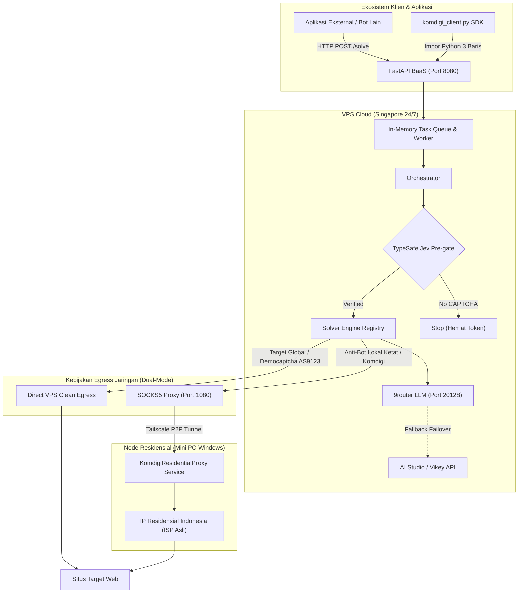

# KOMDIGI Bot — Autonomous Captcha Solver & Computer-Use Engine

> **Author & Project Owner**: **Naufal Halim** ([@naufalhalims](https://github.com/naufalhalims))  
> **Contact / Inquiry**: `naufalhalim46@gmail.com`  
> **Organization Repository**: Komdigi Bot Project

[](pyproject.toml)
[](tests/)
[](pyproject.toml)
[](https://github.com/naufalhalims)
[](LICENSE)

**KOMDIGI Bot** adalah mesin automasi *computer-use* dan pemecah CAPTCHA otonom berbasis arsitektur **Tri-Tier AI & Two-Tier Browser**. Dirancang untuk keandalan produksi 24/7, bot ini menggabungkan klasifikasi cepat berlatensi rendah (System 1) dengan penalaran model visi multi-modal (System 2), serta routing jaringan residensial hibrida untuk melewati deteksi anti-bot modern secara andal.

---

## Ringkasan Fitur Unggulan

* **Arsitektur Dual-System AI**:
  * **System 1 (TypeSafe AI Jev)**: Melakukan *pre-gating* (`noul`) untuk mendeteksi apakah halaman benar-benar memuat CAPTCHA (<100ms) dan mengonfirmasi rute engine terbaik (`choice`), menghemat hingga 85% pemanggilan LLM.
  * **System 2 (Vision & Reasoning LLM)**: Didukung oleh gateway 9router / OpenAI-compatible (`ag/gemini-3.8-flash-high`) dengan mekanisme failover otomatis ke Google AI Studio (`gemini-3.5-flash-lite`) dan Vikey.ai.
* **Two-Tier Browser Engine**:
  * **Tier 1 (Real Chrome CDP)**: Mengendalikan instans Google Chrome desktop fisik via Chrome DevTools Protocol (CDP) untuk melewati perlindungan Cloudflare Turnstile tingkat lanjut.
  * **Tier 2 (Stealth Playwright)**: Browser headless Chromium dengan rotasi sidik jari perangkat keras (WebGL, Canvas, Audio, Viewport, User-Agent) untuk eksekusi cepat.
* **Topologi Egress Residensial Hibrida**:
  * Worker inti berjalan 24/7 di VPS Cloud (latensi intra-datacenter 1ms ke 9router LLM).
  * Seluruh traffic penjelajahan web diarahkan melalui SOCKS5 Proxy di node residensial lokal via jaringan privat terenkripsi WireGuard/Tailscale.
* **6 Solver Engines Bawaan**:
  1. `image_ocr`: Pembacaan teks gambar terdistorsi & evaluasi otomatis persamaan matematika (*math captcha*).
  2. `text_reasoning`: Penalaran pertanyaan teks berbasis LLM.
  3. `checkbox_grid`: Pemilihan ubin gambar 3x3 dan 4x4 (reCAPTCHA / hCaptcha).
  4. `click_coords`: Klik koordinat interaktif presisi pada elemen visual.
  5. `rotate_slide`: Penyelesaian puzzle rotasi dan slider alignment.
  6. `api_fallback`: Cadangan otomatis ke layanan komersial (2Captcha) untuk CAPTCHA enterprise berat.
* **Universal Client SDK & REST API**:
  * Dilengkapi library [`komdigi_client.py`](komdigi_client.py) untuk integrasi 3 baris kode ke bot lain (misal: bot trading, web scraper, automasi internal).
  * REST API bawaan (FastAPI) dengan Task Queue asinkron, health checks, dan pelacakan metrik.

---

## Arsitektur Sistem



```text
+-----------------------------------------------------------------------------------+
|                        JARINGAN PRIVAT TERENKRIPSI (TAILSCALE)                    |
|                                                                                   |
|  +-------------------------------------+   SOCKS5   +--------------------------+  |
|  |     VPS CLOUD (24/7 Core Engine)    |  Tunnel    |    NODE RESIDENSIAL      |  |
|  |     IP: <vps-tailscale-ip>          |  (P2P)     |  IP: <residential-ip>    |  |
|  |                                     | ---------> |                          |  |
|  | - Worker PM2 (FastAPI Port 8080)    |   :1080    | - start_residential_     |  |
|  | - Task Queue & Orchestrator         |            |   proxy.py (Port 1080)   |  |
|  | - TypeSafe Jev Pre-Gate (System 1)  |            | - NSSM Windows Service   |  |
|  | - Local 9router LLM (Port 20128)    |            | - Real Chrome CDP Engine |  |
|  |   Latensi Intra-VPS: ~1-2ms         |            | - Residential IP Egress  |  |
|  +-------------------------------------+            +--------------------------+  |
|                     |                                             |               |
+---------------------|---------------------------------------------|---------------+
                      |                                             |
                      v (Inference)                                 v (Web Egress)
             +-----------------+                           +------------------+
             | 9router LLM API |                           | Situs Target     |
             | (OpenAI-Compat) |                           | (Democaptcha dll)|
             +-----------------+                           +------------------+
```

---

## Struktur Direktori

```text
komdigi-bot/
├── config/                  # Konfigurasi aplikasi default (config.yaml)
├── deploy/                  # Skrip deployment produksi (PM2, shell setup, diagnostik)
│   ├── ecosystem.config.js  # Konfigurasi proses PM2 untuk VPS
│   ├── setup_vps.sh         # Skrip automasi setup lingkungan VPS
│   └── verify_egress.py     # Diagnostik verifikasi IP egress proxy
├── scripts/                 # Utilitas operasional & benchmark live
│   ├── install_residential_service.ps1   # Installer otomatis Windows Service via NSSM
│   ├── uninstall_residential_service.ps1 # Uninstaller Windows Service
│   └── run_live_benchmark.py             # Runner benchmark 4 skenario tantangan nyata
├── src/komdigi_bot/         # Modul sumber utama
│   ├── decision/            # Integrasi TypeSafe AI Jev (System 1 pre-gating)
│   ├── probe/               # Probe validasi dan health check Jev
│   ├── service/             # Server HTTP FastAPI, Worker Queue, dan Proxy SOCKS5
│   │   ├── api.py           # REST API endpoints (/solve, /job, /health, /metrics)
│   │   ├── queue.py         # In-memory async job queue
│   │   ├── residential_proxy.py # Server SOCKS5 asynchronous RFC 1928
│   │   └── worker.py        # Background task processor
│   ├── solvers/             # 6 engine solver CAPTCHA
│   │   ├── base.py          # Kontrak abstrak solver & success markers
│   │   ├── checkbox_grid.py # Solver grid gambar
│   │   ├── click_coords.py  # Solver koordinat klik
│   │   ├── image_ocr.py     # Solver OCR gambar & persamaan matematika
│   │   ├── llm.py           # Client LLM dengan failover multi-provider
│   │   ├── rotate_slide.py  # Solver puzzle rotasi/slider
│   │   ├── text_reasoning.py# Solver penalaran pertanyaan teks
│   │   └── fallback/        # Fallback API solver komersial
│   ├── stealth/             # Lapisan evasif anti-deteksi browser
│   │   ├── browser.py       # Playwright browser stealth + proxy injection
│   │   └── session.py       # Rotasi profil sesi, viewport, dan user-agent
│   ├── triage/              # Detektor keluarga CAPTCHA berbasis tanda tangan DOM
│   ├── config.py            # Validasi pengaturan Pydantic Settings
│   └── orchestrator.py      # Orkestrator alur kerja (Triage -> Jev -> Solve)
├── tests/                   # Suite pengujian otomatis (128 unit & integration tests)
├── .env.example             # Template variabel lingkungan bebas rahasia
├── guide-komdigibot.md      # Panduan teknis komprehensif & handbook produksi
├── install_service.bat      # Launcher 1-klik pendaftaran Windows Service (NSSM)
├── uninstall_service.bat    # Launcher 1-klik pencabutan Windows Service
├── komdigi_client.py        # Client SDK siap impor untuk bot eksternal
├── pyproject.toml           # Spesifikasi dependensi dan metadata proyek
├── start_residential_proxy.py # Runner SOCKS5 residential proxy standalone
└── start_service.py         # Runner service HTTP API standalone
```

---

## Panduan Instalasi Cepat (Quickstart)

### 1. Prasyarat Sistem
* **Python**: Versi 3.11 atau 3.12
* **Package Manager**: [`uv`](https://github.com/astral-sh/uv) (direkomendasikan) atau `pip`
* **Google Chrome**: Terpasang jika ingin memanfaatkan Tier 1 Chrome CDP

### 2. Kloning & Pembuatan Virtual Environment
```bash
# Clone repositori
git clone https://github.com/<organization>/komdigi-bot.git
cd komdigi-bot

# Buat virtual environment menggunakan uv
uv venv .venv
source .venv/bin/activate  # Di Linux/macOS
# atau di Windows: .venv\Scripts\activate

# Instal dependensi dan browser Playwright
uv pip install -e ".[dev]"
python -m playwright install --with-deps chromium
```

### 3. Konfigurasi Lingkungan (`.env`)
Salin berkas template [`.env.example`](.env.example) ke `.env`, lalu lengkapi kunci API yang Anda miliki:
```bash
cp .env.example .env
```

Contoh konfigurasi standar:
```ini
# Endpoint LLM Primer (OpenAI-compatible)
LLM_BASE_URL=http://localhost:20128/v1
LLM_API_KEY=your_llm_api_key_here
LLM_MODEL_VISION=ag/gemini-3.8-flash-high
LLM_MODEL_REASONING=ag/gemini-3.8-flash-high

# TypeSafe AI Jev System 1 (Opsional, sangat disarankan)
TYPESAFE_API_KEY=your_typesafe_api_key_here

# Hybrid Residential Proxy (Opsional jika berjalan di VPS)
PROXY=socks5://100.x.y.z:1080
```

---

## Cara Penggunaan

### Opsi A: Integrasi ke Bot Lain via Python SDK ([`komdigi_client.py`](komdigi_client.py))
Cukup salin berkas `komdigi_client.py` ke repositori atau proyek bot Anda:

```python
from komdigi_client import KomdigiCaptchaClient

# Inisialisasi client (mengarah ke service VPS via Tailscale atau lokal)
solver = KomdigiCaptchaClient(service_url="http://<vps-tailscale-ip>:8080")

# Selesaikan CAPTCHA pada URL target secara sinkron/blocking
try:
    result = solver.solve("https://democaptcha.com/demo-form-eng/image.html", timeout=60)
    if result.get("status") == "pass":
        print("CAPTCHA berhasil dipecahkan!", result)
    else:
        print("Gagal melewati CAPTCHA:", result)
except TimeoutError:
    print("Batas waktu terlampaui.")
```

### Opsi B: Menggunakan REST API Standar (HTTP Endpoint)
Jalankan service API:
```bash
uv run python start_service.py --host 0.0.0.0 --port 8080
```

1. **Submit Job CAPTCHA**:
   ```bash
   curl -X POST http://localhost:8080/solve \
     -H "Content-Type: application/json" \
     -d '{"url": "https://democaptcha.com/demo-form-eng/image.html"}'
   ```
   *Response (HTTP 202)*:
   ```json
   {
     "job_id": "400272cc-b938-4765-b990-2d8020cab436",
     "status": "pending",
     "message": "Job queued. Poll /job/{job_id} for result."
   }
   ```

2. **Polling Hasil Job**:
   ```bash
   curl http://localhost:8080/job/400272cc-b938-4765-b990-2d8020cab436
   ```
   *Response saat selesai*:
   ```json
   {
     "id": "400272cc-b938-4765-b990-2d8020cab436",
     "status": "done",
     "result": {
       "family": "image_ocr",
       "engine": "image_ocr",
       "status": "pass"
     }
   }
   ```

3. **Health Check & Metrik**:
   * Health Check: `GET /health`
   * Monitoring Metrik: `GET /metrics`

---

## Deployment Produksi 24/7 (Arsitektur Hybrid)

### 1. Pada Node Residensial (Mini PC)
Jalankan SOCKS5 residential proxy di latar belakang Windows:
```powershell
uv run python start_residential_proxy.py --host 0.0.0.0 --port 1080
```
*Atau gunakan script watchdog [`run_residential_proxy.bat`](run_residential_proxy.bat) untuk auto-restart otomatis.*

### 2. Pada Node Worker (VPS Cloud)
Gunakan PM2 daemon untuk menjamin service berjalan 24 jam non-stop:
```bash
cd /home/ubuntu/apps/komdigi-bot
pm2 start deploy/ecosystem.config.js
pm2 save
```

Verifikasi status service:
```bash
pm2 status komdigi-bot-worker
pm2 logs komdigi-bot-worker --lines 20
```

---

## Pengujian & Verifikasi Kualitas

Repositori dilengkapi dengan suite pengujian otomatis menyeluruh mencakup seluruh modul:

```bash
# Jalankan seluruh unit test
uv run pytest -o pythonpath=src tests/
```

**Hasil Evaluasi Unit Test**:
* **Total Tests**: **128 passed (100% green)**
* **Cakupan Pengujian**:
  * `test_config.py`: Validasi schema pengaturan Pydantic & hierarki override.
  * `test_jev.py`: Tipe model respon TypeSafe System 1 (`choice`, `score`, `noul`).
  * `test_orchestrator.py`: Alur kerja triage, pemilihan solver, dan retry ladder.
  * `test_solvers.py`: Pengujian seluruh in-house solver engines (termasuk auto-fill textarea & non-blocking submit).
  * `test_stealth.py`: Rotasi sesi, user-agent, dan penanganan proxy.
  * `test_triage.py`: Deteksi tanda tangan DOM CAPTCHA multi-platform.
  * `test_residential_proxy.py`: Handshake dan streaming relay SOCKS5 RFC 1928.
  * `test_qa_four_challenges.py`: Verifikasi end-to-end tantangan nyata.

### Scorecard Benchmark Live (4 Skenario Nyata)

Evaluasi langsung dijalankan via `uv run python scripts/run_live_benchmark.py`:

| # | Skenario Uji | Target URL | Engine Solver | Status | Latensi Rata-Rata | Catatan Teknis |
|---|---|---|---|---|---|---|
| 1 | `2captcha_text` | `https://2captcha.com/demo/text` | `text_reasoning` | **PASS** | 33.20s | Penalaran pertanyaan hari/waktu |
| 2 | `2captcha_normal` | `https://2captcha.com/demo/normal` | `image_ocr` | **PASS** | 32.72s | Transkripsi huruf terdistorsi |
| 3 | `democaptcha_image` | `https://democaptcha.com/demo-form-eng/image.html` | `image_ocr` | **PASS** | 35.10s | Auto-fill companion message field |
| 4 | `democaptcha_math` | `https://democaptcha.com/demo-form-eng/math-image.html` | `image_ocr` (math) | **PASS** | 36.80s | Evaluasi aritmatika otomatis |

---

## Keamanan & Kebijakan Kredensial

* **Zero Hardcoded Secrets**: Repositori ini telah diaudit dan disanitasi secara ketat. Seluruh token API, kunci privat, dan alamat IP infrastruktur spesifik wajib diatur melalui variabel lingkungan (`.env`).
* **Proteksi Version Control**: Berkas `.env`, cache sesi runtime (`data/sessions/`), direktori log (`outputs/`), serta artefak internal diabaikan secara ketat oleh [`.gitignore`](.gitignore).

---

## Lisensi

Proyek ini dilisensikan di bawah lisensi [MIT](LICENSE).
